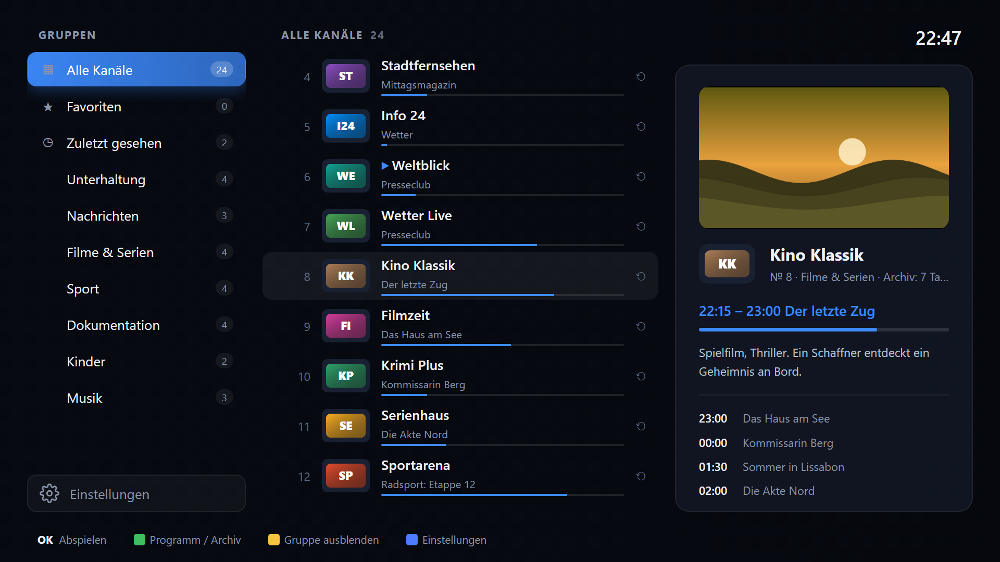
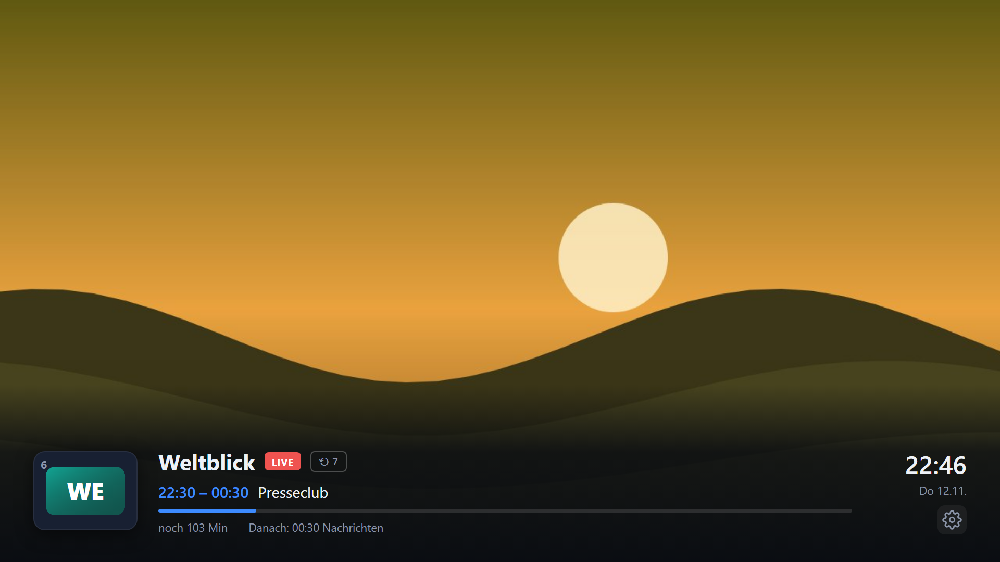
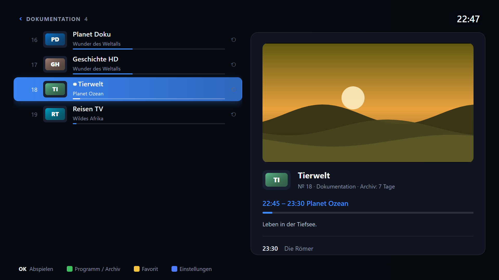
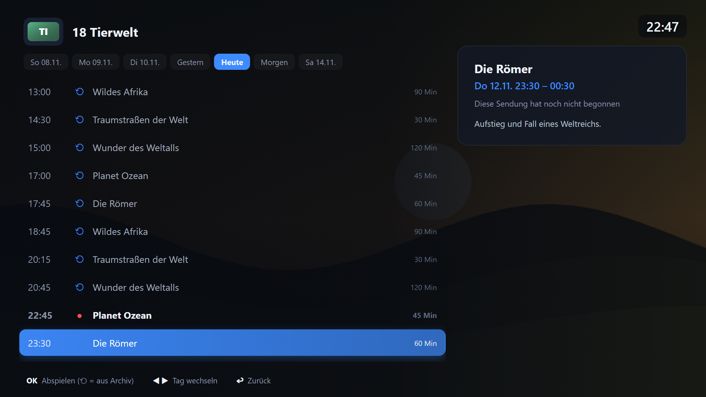
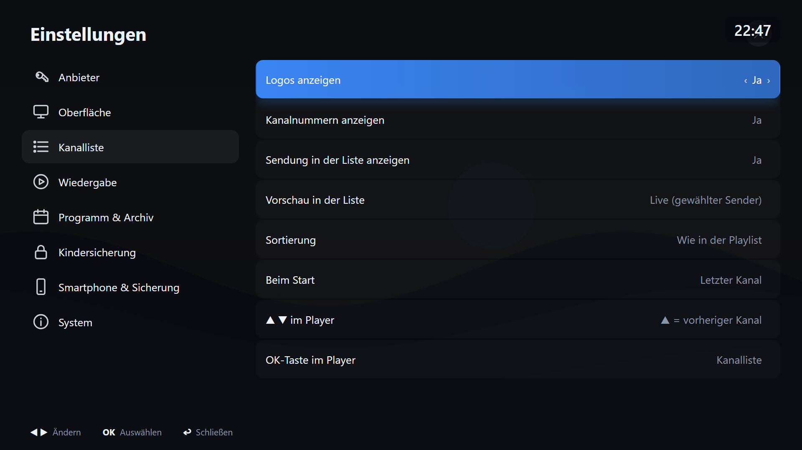
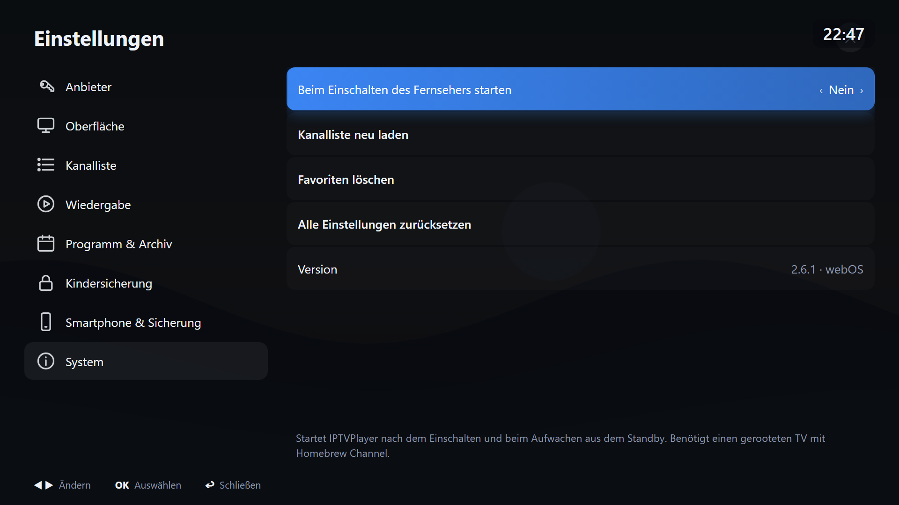
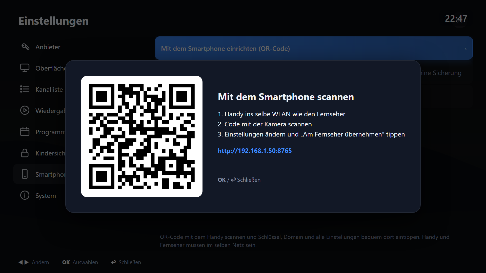
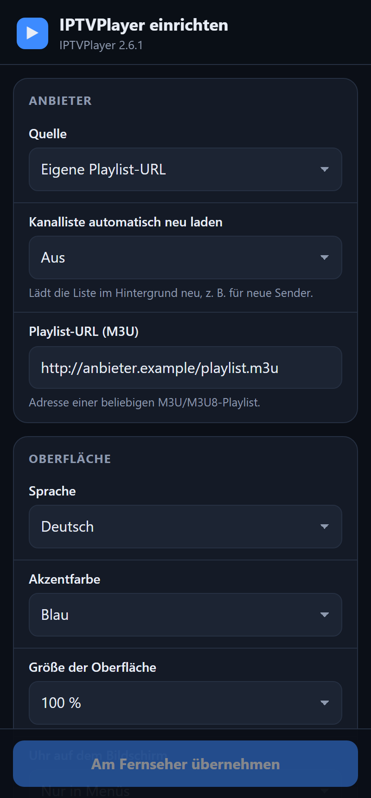

<p align="center">
  
</p>

<h1 align="center">IPTVPlayer</h1>

<p align="center">
  <b>IPTV-App für LG-Fernseher mit webOS</b><br>
  Für Edem TV (iedem.tv) oder jede andere M3U-Playlist, mit Programmführer, Archiv, Live-Vorschau und Einrichtung per Smartphone.
</p>

<p align="center">
  <a href="https://paypal.me/VitalijBleich"></a>
</p>

<p align="center">
  
</p>

> Die Screenshots zeigen eine Beispiel-Senderliste mit erfundenen Sendern. Im Videobereich ist ein Platzhalterbild zu sehen.

---

## Highlights

- 📺 **Edem TV per Code:** nur Zugangsschlüssel und Kanal-Domain eingeben, die App erzeugt die komplette Kanalliste selbst. Alternativ geht jede eigene M3U/M3U8-Playlist.
- 🗂️ **Kanalliste mit Live-Vorschau:** Gruppen, Favoriten, „Zuletzt gesehen“ und „Mit Archiv“. Der gewählte Sender läuft klein in der Vorschau, daneben stehen die laufende Sendung und das Programm.
- 🗓️ **Programmführer (EPG) und Archiv bis 7 Tage:** Sendung auswählen, OK drücken, und sie läuft aus dem Archiv. Mit ⏪ ⏩ springt man in der Sendung.
- 📱 **Einrichtung per Smartphone:** QR-Code am Fernseher scannen und alle Einstellungen bequem am Handy eintippen. Dort lassen sich auch Sicherungen herunterladen und wieder einspielen.
- ⚙️ **Über 50 Einstellungen in 8 Kategorien,** direkt am Fernseher oder am Handy.
- 🔒 **Kindersicherung** mit PIN für Erwachsenen-Gruppen und auf Wunsch für die Einstellungen.
- 🌍 **10 Sprachen:** Deutsch, English, Русский, Українська, Polski, Türkçe, Español, Français, Italiano, Română.
- ⚡ **Autostart** beim Einschalten des Fernsehers (nur auf gerooteten TVs mit Homebrew Channel).
- 🖱️ Bedienung mit der normalen Fernbedienung **oder** mit dem Zeiger der Magic Remote.
- 🧓 Läuft auch auf älteren LG-Fernsehern (ES5-Code, keine modernen Browser-Funktionen nötig).

---

## Screenshots

### Fernsehen mit Info-Leiste
Senderlogo, laufende Sendung mit Fortschritt, nächste Sendung und Archivtage. Die Leiste erscheint beim Umschalten und lässt sich oben oder unten anzeigen.



### Kategorie geöffnet: Kanäle links, Programm und Vorschau rechts
Nach der Auswahl einer Kategorie verschwindet die Gruppenspalte. Die rechte Bildschirmhälfte zeigt dann die große Live-Vorschau, die laufende Sendung mit Beschreibung und die nächsten Sendungen.



### Programmführer und Archiv
Tage wechseln mit ◀ ▶. Sendungen mit ⟲ lassen sich aus dem Archiv abspielen.



### Einstellungen am Fernseher
Acht Kategorien. Änderungen wirken sofort, zu jeder Einstellung steht eine kurze Erklärung.





### Einrichtung per Smartphone

<table>
  <tr>
    <td width="68%"></td>
    <td width="32%"></td>
  </tr>
  <tr>
    <td>QR-Code am Fernseher scannen (Handy im selben WLAN)</td>
    <td>Formular mit allen Einstellungen auf dem Handy</td>
  </tr>
</table>

---

## Alle Funktionen

**Quellen**
- **Edem TV:** nur *Ключ доступа* (Zugangsschlüssel) und *Домен каналов* (Kanal-Domain) aus dem Kabinett eingeben. Die App lädt die aktuelle Edem-Kanalvorlage (epg.one, etwa 4200 Kanäle) und setzt beides ein: `http://<domain>/iptv/<schlüssel>/<kanal>/index.m3u8`. Die Vorlage wird gespeichert, falls der Server einmal nicht erreichbar ist.
- **Eigene Playlist:** beliebige M3U/M3U8-URL, auf Wunsch automatisch alle 6, 12 oder 24 Stunden neu geladen.

**Programmführer**
- Für Edem automatisch von epg.one: „komplett“ mit Archivtagen und Beschreibungen, oder „kompakt“ nur für heute. Alternativ das EPG aus der Playlist (`url-tvg`) oder eine eigene XMLTV-URL.
- Das EPG wird auf dem Fernseher zwischengespeichert und nur in einstellbaren Abständen neu geladen. Gepackte Dateien (`.gz`) funktionieren auch auf älteren Geräten (mitgeliefertes pako).
- Zeitverschiebung ±12 h.

**Archiv (Catch-up)**
- Bis 7 Tage zurück. Formate: Edem/Shift (`utc`/`lutc`), Flussonic und `catchup-source`.
- Sprungweite und Vorlauf einstellbar (die Wiedergabe beginnt 1–10 Minuten früher).

**Kanalliste**
- Gruppen aus der Playlist, dazu Favoriten, „Zuletzt gesehen“ und „Mit Archiv“. Gruppen lassen sich ausblenden (gelbe Taste).
- Live-Vorschau, Logos, Kanalnummern und die laufende Sendung mit Fortschrittsbalken.
- Sortierung, Startkanal, Verhalten von OK sowie ▲▼, automatisches Schließen und Wartezeit nach Zifferneingabe sind einstellbar.

**Wiedergabe**
- Nativer webOS-Player (HLS und MPEG-TS) oder hls.js.
- Bildformat, Puffer, automatische Neuverbindung, Stream-Zeitlimit, bevorzugte Tonspur (Sprache), Untertitel und Sleep-Timer.
- Merkt sich den letzten Kanal. Rote Taste wechselt zum vorigen Kanal.

**Oberfläche**
- 10 Sprachen (Standard ist die Sprache des Fernsehers), 6 Akzentfarben, Größe 80–130 %.
- Uhr, 24/12 h, Dauer und Position der Info-Leiste, deckender oder durchscheinender Menühintergrund, Animationen.

**Smartphone und Sicherung**
- Ein kleiner webOS-Hintergrunddienst (`service/`) startet im Heimnetz einen Web-Server (Port 8765). Zugriff gibt es nur mit dem zufälligen Token aus dem QR-Code; er wird bei jedem App-Start neu erzeugt.
- Änderungen an der Kindersicherung verlangen auch auf dem Handy die PIN.
- Sicherung von Einstellungen und Favoriten auf dem Fernseher oder als JSON-Datei auf dem Handy, später wieder einspielbar.

**Autostart (gerootete TVs)**
- Einstellungen › System › „Beim Einschalten des Fernsehers starten“. Die App legt über den Root-Dienst des [Homebrew Channel](https://github.com/webosbrew/webos-homebrew-channel) ein Startskript in `/var/lib/webosbrew/init.d` an.
- Die App startet dann nach dem Hochfahren und bei jedem Aufwachen aus dem Standby. „Nein“ entfernt das Skript wieder.

---

## Fernbedienung

| Taste | Fernsehen | Kanalliste | Programmführer |
|---|---|---|---|
| OK | Kanalliste | Abspielen | Live / Archiv abspielen |
| ▲ ▼ / CH± | Umschalten | Auswahl / seitenweise | Auswahl |
| ◀ ▶ | Info (im Archiv: ±5 Min) | Gruppen ↔ Kanäle / ▶ = Programm | Tag wechseln |
| 0–9 | Kanalnummer | | |
| ⏪ ⏩ | Archiv ±30 Min | | |
| 🔴 Rot | Letzter Kanal | | |
| 🟢 Grün | Programmführer | Programmführer | Schließen |
| 🟡 Gelb | Favorit | Favorit / Gruppe ausblenden | |
| 🔵 Blau | Einstellungen | Einstellungen | |
| Zurück | Archiv → Live / Liste | Schließen | Zurück zur Liste |

---

## Installation

### Über den Homebrew Channel (gerootete Fernseher)

Am einfachsten geht es über das eigene Repository dieses Projekts. Updates erscheinen dann automatisch im Homebrew Channel.

1. **Homebrew Channel** öffnen → **Settings** (Zahnrad) → ganz unten bei *Repositories* auf **Add repository**.
2. Diese Adresse eingeben:
   ```
   https://vbleich-lab.github.io/IPTVPlayer/api/apps.json
   ```
3. Zurück zur App-Liste: **IPTVPlayer** auswählen → **Install**.

### Manuell im Developer Mode

Die fertige `.ipk`-Datei liegt unter [Releases](../../releases).

1. Auf dem Fernseher die App **Developer Mode** aus dem LG Content Store installieren, mit einem LG-Developer-Konto anmelden, *Dev Mode Status* einschalten und den Fernseher neu starten.
2. Am PC die webOS-CLI installieren und den Fernseher verbinden (IP und Passphrase stehen in der Developer-Mode-App):
   ```bash
   npm install -g @webos-tools/cli
   ares-setup-device            # Gerät "tv" mit der TV-IP anlegen
   ares-novacom --device tv --getkey
   ```
3. Installieren und starten:
   ```bash
   ares-install --device tv com.iptvplayer.app_2.7.0_all.ipk
   ares-launch --device tv com.iptvplayer.app
   ```
4. In der App den Zugangsschlüssel und die Kanal-Domain eintragen (oder eine Playlist-URL), am bequemsten per Smartphone über den QR-Code. Der erste EPG-Download kann einige Minuten dauern. Er läuft im Hintergrund; danach kommt das EPG sofort aus dem Cache.

> Im Developer Mode läuft die Sitzung nach 50 Stunden ab und muss in der Developer-Mode-App verlängert werden, sonst entfernt der Fernseher die App.

### Umstieg von Version 2.6 und älter

Bis Version 2.6 hieß die App intern `com.edemtv.player`, ab 2.7 heißt sie `com.iptvplayer.app`. Der Fernseher sieht sie deshalb als neue App.
1. In der alten App: Einstellungen › *Smartphone & Sicherung* → QR-Code scannen → auf dem Handy **Sicherung herunterladen**.
2. Die neue Version installieren und die alte deinstallieren.
3. In der neuen App per QR-Code die Sicherung wieder hochladen. Einstellungen und Favoriten sind dann zurück.
4. Wer den Autostart benutzt hat: in der neuen App unter Einstellungen › System einmal „Nein“ und wieder „Ja“ wählen. Dann startet der Fernseher die neue App.

## Selbst bauen

```bash
npx -p @webos-tools/cli ares-package app service -o dist -e demo
```
Das baut die App und den Hintergrunddienst zu `dist/com.iptvplayer.app_<version>_all.ipk`.

**Neue Version veröffentlichen:**
1. Version in `app/appinfo.json` erhöhen und neu bauen (Befehl oben).
2. Das Repository für den Homebrew Channel aktualisieren. Das Skript trägt Version, Download-Link und Prüfsumme in `docs/api/` ein:
   ```bash
   node tools/make-repo.js
   ```
3. Genau diese `.ipk` als Release hochladen, dann committen und pushen:
   ```bash
   gh release create v<version> dist/com.iptvplayer.app_<version>_all.ipk
   ```

## Im Browser testen

```bash
npx http-server -p 8137
```
Dann `http://localhost:8137/app/index.html?playlist=demo/demo.m3u` öffnen (Tasten: Pfeile, Enter, Backspace = Zurück).
`node app/demo/make-epg.js` erzeugt ein Demo-EPG um die aktuelle Uhrzeit. Für die Smartphone-Einrichtung zusätzlich `node service/index.js` starten; am PC läuft das ohne webOS als normaler Server.

## Projektaufbau

```
app/               webOS-App (HTML/CSS/ES5-JavaScript)
  js/app.js        Oberfläche, Steuerung, Einstellungen
  js/player.js     Wiedergabe (nativ / hls.js), Tonspur, Untertitel
  js/epg.js        XMLTV-Parser mit IndexedDB-Cache
  js/m3u.js        Playlist-Parser
  js/i18n.js       Übersetzungen (10 Sprachen)
service/           webOS-JS-Dienst: Web-Server für die Smartphone-Einrichtung
docs/screenshots/  Bilder für diese Seite
```

## Unterstützen

Dir gefällt die App? Über eine kleine Spende freue ich mich sehr. Sie hilft, IPTVPlayer weiterzuentwickeln.

<a href="https://paypal.me/VitalijBleich"></a>

## Hinweise

- Inoffizielles Projekt, nicht verbunden mit LG oder Edem TV. Die App enthält keine Sender oder Zugangsdaten; man braucht ein eigenes Abo oder eine eigene Playlist.
- Mitgelieferte Bibliotheken: [pako](https://github.com/nodeca/pako) (MIT/Zlib) und [QR Code Generator](https://github.com/kazuhikoarase/qrcode-generator) (MIT). [hls.js](https://github.com/video-dev/hls.js) (Apache-2.0) wird bei Bedarf nachgeladen.
