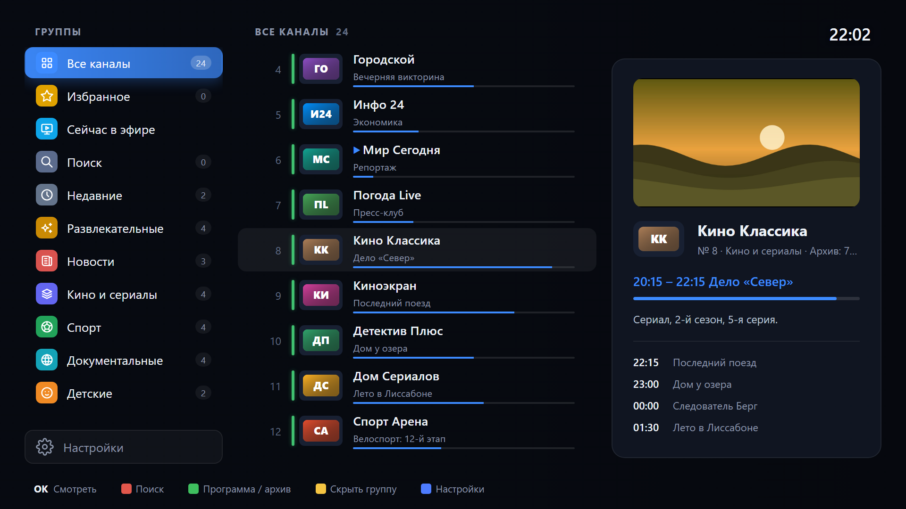
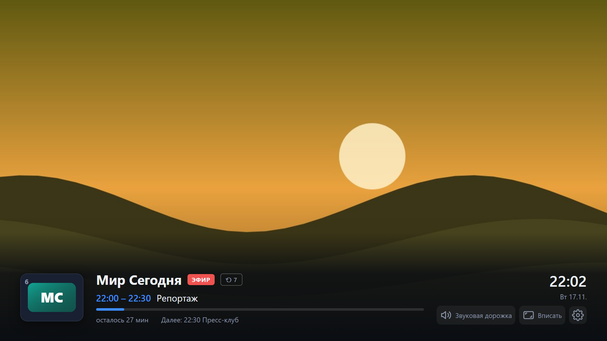
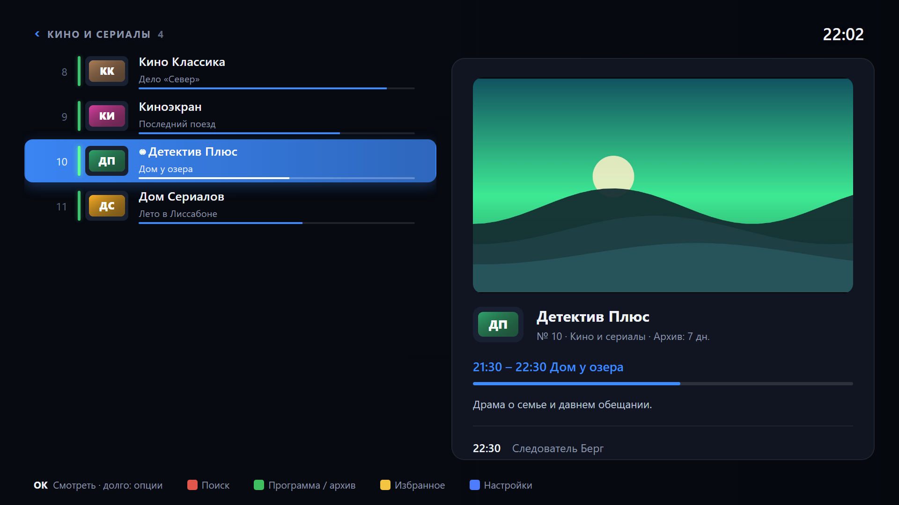
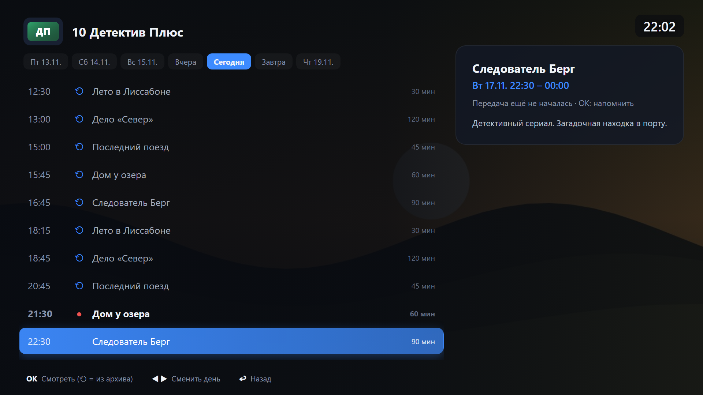
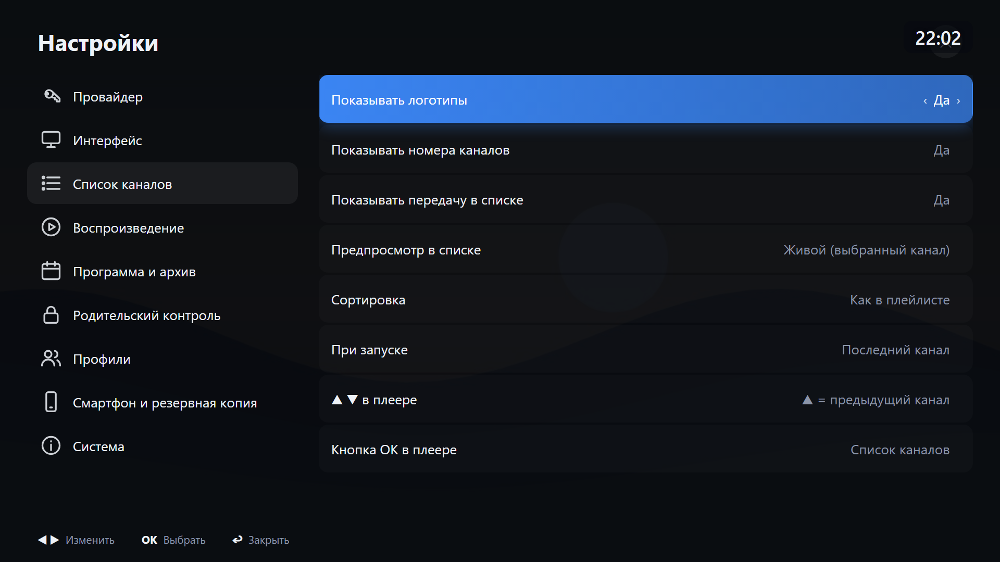
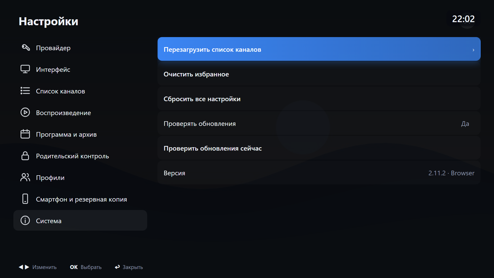
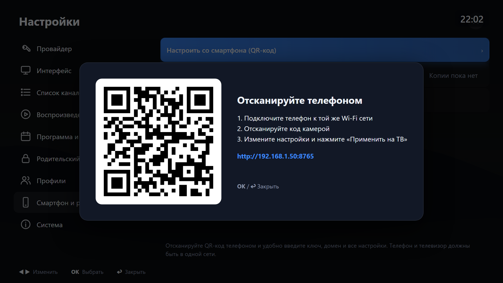
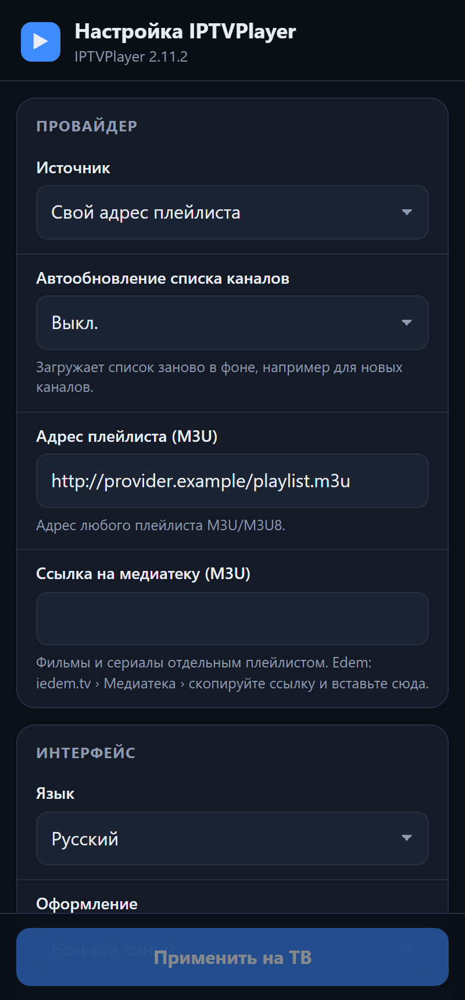

<p align="center">
  
</p>

<h1 align="center">IPTVPlayer</h1>

<p align="center"><b>Русский</b> · <a href="README.de.md">Deutsch</a></p>

<p align="center">
  <b>IPTV-приложение для смарт-телевизоров: LG webOS, Samsung Tizen, Android TV / Google TV / Fire TV</b><br>
  Для Edem TV (iedem.tv) или любого другого M3U-плейлиста: телегид, архив, живое превью и настройка со смартфона.
</p>

<p align="center">
  <a href="https://paypal.me/VitalijBleich"></a>
</p>

<p align="center">
  
</p>

> На скриншотах показан пример списка с вымышленными каналами. В области видео — изображение-заглушка.

## Какой файл для какого телевизора?

| Телевизор | Файл из [Releases](../../releases) | Установка |
|---|---|---|
| **LG** (webOS 3 и новее) | `com.iptvplayer.app_<version>_all.ipk` | [Homebrew Channel или Developer Mode](#lg-webos) |
| **Samsung** (Tizen, примерно с 2017 года) | `IPTVPlayer-<version>.wgt` | [TizenBrew Installer или Tizen Studio](#samsung-tizen) |
| **Android TV, Google TV, Fire TV**, напр. Philips, Sony, TCL, Hisense (Android), Xiaomi, Nvidia Shield, ТВ-стики | `IPTVPlayer-<version>.apk` | [Установка APK](#android-tv--google-tv--fire-tv) |

Все три версии собраны из одного кода и выглядят одинаково.

---

## Главное

- 📺 **Edem TV по коду:** достаточно ввести ключ доступа и домен каналов — приложение само создаст полный список каналов. Также подходит любой свой M3U/M3U8-плейлист.
- 🗂️ **Список каналов с живым превью:** группы, избранное, «Недавние» и «С архивом». Выбранный канал идёт в маленьком окне превью, рядом — текущая передача и программа.
- 🎬 **Медиатека:** фильмы и сериалы из своего плейлиста (у Edem: *Медиатека*), с постерами, перемоткой и «Продолжить просмотр» с места остановки.
- 🗓️ **Телегид (EPG) и архив до 7 дней:** выберите передачу, нажмите OK — и она запустится из архива. Кнопками ⏪ ⏩ можно перемещаться внутри передачи.
- 📱 **Настройка со смартфона:** отсканируйте QR-код на телевизоре и вводите все настройки на телефоне. Там же можно скачать резервную копию и загрузить её обратно.
- ⚙️ **Более 50 настроек в 8 разделах** — прямо на телевизоре или на телефоне.
- 🔒 **Родительский контроль** с PIN-кодом для взрослых групп и, при желании, для настроек.
- 🌍 **22 языка:** Русский, Deutsch, English, Українська, Polski, Türkçe, Español, Français, Italiano, Română, Português, Nederlands, Čeština, Slovenčina, Magyar, Български, Ελληνικά, Lietuvių, Latviešu, Eesti, Қазақша, Беларуская.
- ⚡ **Автозапуск** при включении телевизора (LG с root или в Developer Mode, Android TV).
- 🖱️ Управление обычным пультом **или** указкой Magic Remote.
- 🧓 Работает и на старых телевизорах (код ES5, современные функции браузера не нужны).

---

## Скриншоты

### Просмотр с инфопанелью
Логотип канала, текущая передача с прогрессом, следующая передача и дни архива. Панель появляется при переключении и может быть сверху или снизу.



### Открытая категория: каналы слева, программа и превью справа
После выбора категории столбец групп скрывается. В правой половине экрана — большое живое превью, текущая передача с описанием и следующие передачи.



### Телегид и архив
Дни переключаются кнопками ◀ ▶. Передачи со значком ⟲ можно смотреть из архива.



### Настройки на телевизоре
Восемь разделов. Изменения действуют сразу, к каждой настройке есть короткое пояснение.





### Настройка со смартфона

<table>
  <tr>
    <td width="68%"></td>
    <td width="32%"></td>
  </tr>
  <tr>
    <td>Отсканируйте QR-код на телевизоре (телефон в той же сети Wi-Fi)</td>
    <td>Форма со всеми настройками на телефоне</td>
  </tr>
</table>

---

## Все функции

**Источники**
- **Edem TV:** введите *Ключ доступа* и *Домен каналов* из личного кабинета. Приложение загружает актуальный шаблон каналов Edem (epg.one, около 4200 каналов) и подставляет оба значения: `http://<домен>/iptv/<ключ>/<канал>/index.m3u8`. Шаблон сохраняется на случай, если сервер будет недоступен.
- **Свой плейлист:** любая M3U/M3U8-ссылка, при желании с автоматическим обновлением каждые 6, 12 или 24 часа.
- **Несколько провайдеров:** Настройки › Провайдер › «Добавить провайдера» создаёт второго (до восьми) провайдера. Данные входа, плейлист, медиатека и телегид хранятся отдельно для каждого; «Активный провайдер» переключает между ними, и каждый провайдер снова запускается со своего последнего канала. Там же — переименование и удаление.

**Медиатека (фильмы и сериалы)**
- Edem: в личном кабинете в разделе *Медиатека* скопируйте ссылку и вставьте её в Настройки › Провайдер › *Ссылка на медиатеку* (проще всего со смартфона). Любой другой VOD-плейлист в формате M3U работает так же.
- Открывается через группу **Медиатека** в списке каналов. Слева — категории из плейлиста, а также «Продолжить просмотр» и «Все».
- OK запускает или продолжает с запомненного места, 🔴 красная кнопка — сначала. В фильме: ◀ ▶ ±30 с, ⏪ ⏩ ±5 мин, OK — пауза, «Назад» возвращает в медиатеку, затем снова идёт эфирный канал.

**Телегид**
- Для Edem автоматически с epg.one: «полный» с днями архива и описаниями или «компактный» только на сегодня. Либо EPG из плейлиста (`url-tvg`) или своя XMLTV-ссылка.
- EPG сохраняется на телевизоре и обновляется только с заданным интервалом. Сжатые файлы (`.gz`) работают и на старых устройствах (встроенный pako).
- Сдвиг времени ±12 ч.
- **Напоминания:** OK на будущей передаче ставит напоминание (⏰), повторное OK его снимает. Незадолго до начала (в начале или за 1, 2, 5 минут) приложение спрашивает «Переключить на …?» или, если так настроено, переключает само (Программа и архив › «При напоминании»). Если канал уже идёт, появится только подсказка.

**Архив (Catch-up)**
- До 7 дней назад. Форматы: Edem/Shift (`utc`/`lutc`), Flussonic и `catchup-source`.
- Настраиваются шаг перемотки и запас (воспроизведение начинается на 1–10 минут раньше).

**Список каналов**
- Группы из плейлиста, а также избранное, «Недавние» и «С архивом». Группы можно скрывать (жёлтая кнопка).
- **Параметры канала:** долгое нажатие OK на канале открывает меню: в избранное / из избранного, переместить (в избранном), заблокировать PIN-кодом, скрыть канал и проверить канал. У заблокированных каналов виден замок и запрашивается PIN; скрытые видны только с «Показывать скрытые». Снять: Родительский контроль › «Снять все блокировки каналов» или Список каналов › «Показать все снова».
- **Сортировка избранного:** в избранном долгое OK › «Переместить», двигать ▲ ▼ (CH± — в начало или в конец), OK — готово. Порядок сохраняется в резервной копии.
- **Профили:** Настройки › Профили: до 9 профилей со своим избранным, историей, последним каналом, форматами изображения, а также скрытыми и заблокированными каналами. Настройки общие для всех. С «Спрашивать при запуске» при старте появляется «Кто смотрит?».
- **Заставка при запуске:** при старте показывается логотип IPTVPlayer на цветном фоне, пока не запустится первый канал (отключается в Интерфейс › «Заставка при запуске»).
- **Обновления:** при запуске приложение проверяет, есть ли новая версия, и спрашивает: «Обновить сейчас» или «При следующем запуске». LG с root: установка через службу Homebrew Channel. LG в Developer Mode: собственная служба скачивает .ipk, проверяет контрольную сумму и устанавливает её. После этого перезапустите IPTVPlayer. Android: APK скачивается и открывается установка (один раз разрешите «Установку неизвестных приложений»). Samsung: подсказка о новом .wgt. Отключается в Система › «Проверять обновления»; там же «Проверить обновления сейчас». Описание новой версии показывается на языке интерфейса.
- **Оформление:** Настройки › Интерфейс › Оформление: Ночной синий (по умолчанию), OLED-чёрный, Графит, Океан, Аврора или Светлое. Цвет акцента выбирается отдельно. В «Форма логотипов» логотипы каналов бывают скруглёнными, круглыми или квадратными, в «Цвет шрифта» выбирается цвет текста (белый, кремовый, жёлтый, голубой, светло-зелёный, розовый, чёрный). В Список каналов › «Значки категорий» категории получают значки: цветные плитки, линейные значки или буквы (определяются по названию, напр. Спорт, Кино, Новости, группы стран).
- **Свои номера избранного:** в избранном каналы нумеруются по позиции (1, 2, 3 …). Пока идёт канал из избранного, цифровые кнопки выбирают эти номера.
- **Поиск:** красная кнопка в списке каналов или категория «Поиск». Введите название канала на экранной клавиатуре; результаты из всех категорий появляются уже при вводе (части названия или номер канала тоже подходят). С 3 символов ниже идут подходящие передачи из телегида: текущие запускаются в эфире, прошедшие — из архива, будущие открывают телегид на этом месте. OK или ▼ переходит в список результатов.
- Живое превью, логотипы, номера каналов и текущая передача с полосой прогресса.
- **Свои логотипы каналов:** Список каналов › «Источник логотипов» загружает логотипы для каналов без логотипа из коллекции, напр. `https://…/{slug}.png` (подстановки `{name}`, `{slug}`, `{id}` = tvg-id). В «Изменить логотипы со смартфона» на телефоне можно задать каждому каналу свой адрес изображения; «Удалить свой логотип» — в параметрах канала (долгое OK).
- Настраиваются сортировка, стартовый канал, поведение OK и ▲▼, автоматическое закрытие и задержка после ввода цифр.

**Воспроизведение**
- Встроенный плеер телевизора (HLS и MPEG-TS) или hls.js.
- Формат изображения, буфер, автоматическое переподключение, тайм-аут потока, предпочитаемая звуковая дорожка (язык), субтитры и таймер сна.
- Запускается с последнего канала в последней использованной категории (переключение и список остаются в ней). Красная кнопка — предыдущий канал.
- **Выбор звуковой дорожки:** ▶ во время просмотра показывает инфопанель с кнопкой «Звуковая дорожка»; OK открывает выбор. Выбранную дорожку приложение запоминает для каждого канала.
- **Формат изображения для каждого канала:** ▶ ▶ выбирает в инфопанели соседнюю кнопку; каждое OK переключает дальше (вписать, заполнить, растянуть, увеличить). Формат запоминается для каждого канала.
- **Сведения о картинке:** инфопанель показывает разрешение, частоту кадров, кодек и битрейт, если плеер их сообщает (отключается в Воспроизведение › «Сведения о картинке»).
- **Пауза эфира:** пауза (❚❚ или ▶❚❚) останавливает эфирное изображение. Если у канала есть архив, ▶ или OK продолжает ровно с этого места (из архива); без архива — возврат в эфир. Стоп или «Назад» сразу возвращает в эфир.
- **Сейчас в эфире:** плитки с тем, что сейчас идёт на каналах из избранного (без избранного — все каналы с программой), с прогрессом, оставшимся временем и следующей передачей. Открывается через категорию «Сейчас в эфире» или кнопкой ►► во время просмотра; OK переключает, зелёная кнопка открывает телегид.
- **Будильник:** Воспроизведение › «Будильник» в заданное время (каждый день, Пн–Пт или Сб и Вс) включает выбранный канал. Телевизор должен быть включён: для этого настройте таймер включения телевизора (LG: Настройки › Общие › Таймеры). Если IPTVPlayer закрыт, webOS (Developer Mode, через службу) и Android запускают приложение сами; на Samsung — только пока приложение открыто.
- **Стиль субтитров:** размер, цвет (белый, жёлтый, голубой) и фон (тень, подложка, без фона) субтитров, когда субтитры включены.
- **Проверка канала:** Воспроизведение › «Проверить текущий канал» или «Проверить канал» в параметрах канала измеряет время ответа сервера, уровни качества, скорость загрузки и обрывы и показывает, хватает ли скорости соединения (хорошо, на грани, слишком медленно, недоступен). Показывается только имя сервера, никогда полный адрес с ключом доступа.
- **Заставка:** только когда изображение на паузе или список каналов открыт без нажатий, через 1–10 минут (Интерфейс › «Заставка») появляются плавающие часы с каналом и передачей на чёрном фоне. Любая кнопка её закрывает.

**Интерфейс**
- 22 языка (по умолчанию язык телевизора), 6 цветов акцента, масштаб 80–130 %.
- Часы, 24/12 ч, время показа и положение инфопанели, непрозрачный или полупрозрачный фон меню, анимации.

**Смартфон и резервная копия**
- На LG небольшая фоновая служба webOS (`service/`) запускает в домашней сети веб-сервер (порт 8765), на Android это делает само приложение. Доступ возможен только со случайным токеном из QR-кода; он создаётся заново при каждом запуске приложения.
- Изменения родительского контроля и на телефоне требуют PIN-код.
- Резервная копия настроек, избранного, провайдеров и своих логотипов на телевизоре или в виде JSON-файла на телефоне, которую позже можно загрузить обратно.

**Автозапуск (LG с root или в Developer Mode, Android TV)**
- Настройки › Система › «Запускать при включении телевизора».
- **LG с root:** через root-службу [Homebrew Channel](https://github.com/webosbrew/webos-homebrew-channel) приложение создаёт скрипт запуска в `/var/lib/webosbrew/init.d`. Тогда оно запускается после загрузки и при каждом выходе из режима ожидания. «Нет» удаляет скрипт.
- **LG в Developer Mode (без root):** фоновая служба приложения создаёт постоянную задачу в Activity Manager телевизора. Она запускает IPTVPlayer после загрузки и после выхода из режима ожидания (Quick Start+). Под пояснением к настройке показан короткий журнал (событие, запуск приложения). «Нет» удаляет задачу. Этот способ официально не документирован и проверен не на всех моделях; если телевизор его отклонит, приложение покажет сообщение об ошибке.
- Android: см. [Автозапуск на Android](#android-tv--google-tv--fire-tv).

---

## Пульт

| Кнопка | Просмотр | Список каналов | Телегид |
|---|---|---|---|
| OK | Список каналов | Воспроизвести | Эфир / архив |
| ▲ ▼ / CH± | Переключение | Выбор / постранично | Выбор |
| ◀ ▶ | Инфо (в архиве: ±5 мин) | Группы ↔ каналы / ▶ = программа | Сменить день |
| 0–9 | Номер канала | | |
| ⏪ ⏩ | Архив ±30 мин | | |
| 🔴 Красная | Предыдущий канал | | |
| 🟢 Зелёная | Телегид | Телегид | Закрыть |
| 🟡 Жёлтая | Избранное | Избранное / скрыть группу | |
| 🔵 Синяя | Настройки | Настройки | |
| Назад | Архив → эфир / список (Samsung/Android: 2× = выйти) | Закрыть | Назад к списку |

Пульты Android без цветных кнопок: **Меню** открывает настройки (как синяя), **Guide** — телегид (как зелёная).

---

## Установка

## LG webOS

### Через Homebrew Channel (телевизоры с root)

Проще всего — через собственный репозиторий этого проекта. Тогда обновления сами появляются в Homebrew Channel.

1. Откройте **Homebrew Channel** → **Settings** (шестерёнка) → в самом низу в разделе *Repositories* нажмите **Add repository**.
2. Введите адрес:
   ```
   https://vbleich-lab.github.io/IPTVPlayer/api/apps.json
   ```
3. Вернитесь к списку приложений: выберите **IPTVPlayer** → **Install**.

### Вручную в Developer Mode

Готовый `.ipk`-файл находится в [Releases](../../releases).

1. На телевизоре установите приложение **Developer Mode** из LG Content Store, войдите с аккаунтом LG Developer, включите *Dev Mode Status* и перезагрузите телевизор.
2. На ПК установите webOS CLI и подключите телевизор (IP и Passphrase показаны в приложении Developer Mode):
   ```bash
   npm install -g @webos-tools/cli
   ares-setup-device            # создать устройство "tv" с IP телевизора
   ares-novacom --device tv --getkey
   ```
3. Установите и запустите:
   ```bash
   ares-install --device tv com.iptvplayer.app_<version>_all.ipk
   ares-launch --device tv com.iptvplayer.app
   ```
4. В приложении введите ключ доступа и домен каналов (или ссылку на плейлист) — удобнее всего со смартфона через QR-код. Первая загрузка EPG может занять несколько минут. Она идёт в фоне; затем EPG сразу берётся из кэша.

> В Developer Mode сессия истекает через 50 часов, её нужно продлевать в приложении Developer Mode, иначе телевизор удалит приложение.

### Переход с версии 2.6 и старше (LG)

До версии 2.6 приложение внутри называлось `com.edemtv.player`, с 2.7 — `com.iptvplayer.app`. Поэтому телевизор считает его новым приложением.
1. В старом приложении: Настройки › *Смартфон и резервная копия* → отсканируйте QR-код → на телефоне **Скачать копию**.
2. Установите новую версию и удалите старую.
3. В новом приложении через QR-код снова загрузите копию. Настройки и избранное вернутся.
4. Если вы пользовались автозапуском: в новом приложении в Настройки › Система один раз выберите «Нет», а затем снова «Да». Тогда телевизор будет запускать новое приложение.

## Samsung (Tizen)

Samsung разрешает приложения вне магазина только со своей подписью. Проще всего — **TizenBrew Installer**: он берёт приложение прямо с GitHub и подписывает его вашим собственным сертификатом Samsung.

**Tizen 7 и новее (телевизоры примерно с 2023 года):**
1. Включите на телевизоре режим разработчика: откройте *Apps*, нажмите на пульте **1 2 3 4 5**, переключите *Developer mode* в **On** и введите IP-адрес ПК. Перезагрузите телевизор.
2. На ПК запустите [TizenBrew Installer](https://github.com/reisxd/TizenBrewInstaller/releases) и подключите телевизор.
3. Выберите **Install from GitHub** и введите:
   ```
   vbleich-lab/IPTVPlayer
   ```
   Установщик возьмёт `.wgt` из последнего релиза, подпишет его (вход в аккаунт Samsung) и установит.

**Старые телевизоры Samsung (Tizen 3–6):**
`.wgt` из [Releases](../../releases) нужно подписать своим сертификатом Samsung:
1. Установите [Tizen Studio](https://developer.samsung.com/smarttv/develop/getting-started/setting-up-sdk/installing-tv-sdk.html) с *Samsung Certificate Extension* и в *Certificate Manager* создайте сертификат Samsung для телевизора (указав DUID телевизора).
2. Включите режим разработчика на телевизоре, как описано выше.
3. Подпишите и установите:
   ```bash
   tizen package -t wgt -s <профиль_сертификата> -- IPTVPlayer-<version>.wgt
   sdb connect <IP-телевизора>
   tizen install -n IPTVPlayer-<version>.wgt -t <имя-телевизора>
   ```

На Samsung нет настройки со смартфона (приложения Tizen не могут запускать веб-сервер) и нет автозапуска. Всё настраивается пультом.

## Android TV / Google TV / Fire TV

`.apk` из [Releases](../../releases) работает начиная с Android 5 на телевизорах, ТВ-приставках и стиках (в том числе Fire TV), а также на планшетах.

**С приложением «Downloader»** (Google Play или Amazon Appstore):
1. На телевизоре разрешите установку из неизвестных источников для *Downloader* (Android TV: *Настройки › Приложения › Безопасность › Неизвестные источники*; Fire TV: *Мой Fire TV › Параметры разработчика › Приложения из неизвестных источников*).
2. В *Downloader* введите ссылку на `.apk` из последнего релиза, скачайте и установите.

**Или через ADB с ПК** (на телевизоре заранее включите *Параметры разработчика › Отладка по USB/сети*):
```bash
adb connect <IP-телевизора>
adb install -r IPTVPlayer-<version>.apk
```

После этого IPTVPlayer появится в списке приложений телевизора. Настройка со смартфона (QR-код) работает так же, как на LG.

**Автозапуск на Android:** Настройки › Система › «Запускать при включении телевизора». Android разрешает запуск приложения из фона только с разрешением **«Поверх других приложений»**; IPTVPlayer сам открывает нужную страницу настроек. На устройствах без этой страницы (некоторые модели Fire TV и Android TV) — через ADB:
```bash
adb shell appops set com.iptvplayer.app SYSTEM_ALERT_WINDOW allow
```

## Сборка

```bash
npx -p @webos-tools/cli ares-package app service -o dist -e demo   # LG:      dist/com.iptvplayer.app_<version>_all.ipk
node tools/build-tizen.js                                          # Samsung: dist/IPTVPlayer-<version>.wgt (без подписи)
bash tools/build-android.sh                                        # Android: dist/IPTVPlayer-<version>.apk
```
Для Android нужны Android SDK (build-tools и платформа), JDK и Python 3, Gradle не нужен. При первом запуске скрипт создаёт ключ подписи `~/.android/iptvplayer-release.jks`. **Сохраните этот ключ:** обновления устанавливаются поверх установленной версии только с тем же ключом.

**Выпуск новой версии:**
1. Увеличьте версию в `app/appinfo.json`, `service/package.json` и `VERSION` в `app/js/app.js` и пересоберите все три пакета (команды выше).
2. Обновите репозиторий для Homebrew Channel. Скрипт записывает версию, ссылку для скачивания и контрольную сумму в `docs/api/`:
   ```bash
   node tools/make-repo.js
   ```
3. Сделайте commit и push и загрузите все три файла в релиз (именно этот `.ipk` — из-за контрольной суммы; `.wgt` должен быть в последнем релизе, чтобы его нашёл TizenBrew Installer). Описание релиза: русский раздел после `<!-- lang:ru -->`, немецкий после `<!-- lang:de -->`; приложение показывает раздел на языке интерфейса, иначе русский.
   ```bash
   gh release create v<version> dist/com.iptvplayer.app_<version>_all.ipk dist/IPTVPlayer-<version>.wgt dist/IPTVPlayer-<version>.apk
   ```

## Тест в браузере

```bash
npx http-server -p 8137
```
Затем откройте `http://localhost:8137/app/index.html?playlist=demo/demo.m3u` (кнопки: стрелки, Enter, Backspace = Назад).
`node app/demo/make-epg.js` создаёт демо-EPG вокруг текущего времени. Для настройки со смартфона дополнительно запустите `node service/index.js`; на ПК без webOS он работает как обычный сервер.

## Структура проекта

```
app/               Приложение (HTML/CSS/JavaScript ES5), общее для всех платформ
  js/platform.js   Различия LG / Samsung / Android (кнопки, выход, автозапуск)
  js/app.js        Интерфейс, управление, настройки
  js/player.js     Воспроизведение (встроенный плеер / hls.js), звуковые дорожки, субтитры
  js/epg.js        Парсер XMLTV с кэшем в IndexedDB
  js/m3u.js        Парсер плейлистов
  js/i18n.js       Переводы (22 языка)
service/           JS-служба webOS: веб-сервер для настройки со смартфона (LG)
tizen/config.xml   Описание пакета Samsung
android/           Оболочка Android (Java): WebView, кнопки пульта, сервер для телефона, автозапуск
tools/             Скрипты сборки, значки, репозиторий Homebrew
docs/screenshots/  Изображения для этой страницы
```

## Поддержать

Нравится приложение? Буду очень рад небольшому пожертвованию — оно помогает развивать IPTVPlayer.

<a href="https://paypal.me/VitalijBleich"></a>

## Примечания

- Неофициальный проект, не связан с LG, Samsung, Google, Amazon или Edem TV. Приложение не содержит каналов и данных доступа; нужна своя подписка или свой плейлист.
- Встроенные библиотеки: [pako](https://github.com/nodeca/pako) (MIT/Zlib) и [QR Code Generator](https://github.com/kazuhikoarase/qrcode-generator) (MIT). [hls.js](https://github.com/video-dev/hls.js) (Apache-2.0) загружается при необходимости.
